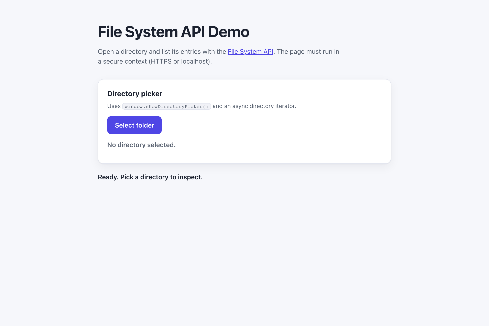

# WebSharper.FileSystem

[](https://github.com/dotnet-websharper/FileSystemAPI)

WebSharper bindings for the [File System API](https://developer.mozilla.org/en-US/docs/Web/API/File_System_API) —
opening directories and files, reading their contents, and writing changes back from F# and C# web apps.

The File System API is only available in [secure contexts](https://developer.mozilla.org/en-US/docs/Web/Security/Defenses/Secure_Contexts)
(HTTPS or localhost), and the browser asks the user to pick a directory before the page can read it.

This repository contains:

| Project | Purpose |
| --- | --- |
| `WebSharper.FileSystem` | The binding: WIG definitions for `FileSystemHandle`, `FileSystemFileHandle`, `FileSystemDirectoryHandle`, `FileSystemWritableFileStream`, `FileSystemSyncAccessHandle`, `FileSystemObserver`, and their option dictionaries. |
| `WebSharper.FileSystem.Extensions` | `[<Inline>]` client extensions: `window.showDirectoryPicker()`, `showOpenFilePicker()`, and `showSaveFilePicker()`. |
| `WebSharper.FileSystem.Sample` | An ASP.NET Core SPA that opens a directory and lists its entries. |

## Live demos

**Try it live:** [Open the sample in your browser](https://dotnet-websharper.github.io/FileSystemAPI/)



The sample doubles as the binding's test case: it exercises the directory picker and the async directory iterator in a real browser.

- **Sample (this repository):** <https://dotnet-websharper.github.io/FileSystemAPI/>
- **Source repository:** <https://github.com/dotnet-websharper/FileSystemAPI>
- **WebSharper bindings:** <https://websharper.com/bindings>

## Features

- `FileSystemHandle` (`kind`, `name`, `isSameEntry`, `queryPermission`, `requestPermission`, `remove`).
- `FileSystemFileHandle` (`getFile`, `createWritable`, `createSyncAccessHandle`).
- `FileSystemDirectoryHandle` (`getDirectoryHandle`, `getFileHandle`, `removeEntry`, `resolve`, and the async `entries`/`keys`/`values` iterators).
- `FileSystemWritableFileStream` (`write`, `seek`, `truncate`) and `FileSystemSyncAccessHandle`.
- The experimental `FileSystemObserver` and its `FileSystemChangeRecord` callback.
- `showDirectoryPicker()`, `showOpenFilePicker()`, and `showSaveFilePicker()` in the Extensions assembly.

## Installation

The binding is not currently published to NuGet. Reference the projects from source:

```bash
git clone https://github.com/dotnet-websharper/FileSystemAPI.git
```

```xml
<ItemGroup>
  <ProjectReference Include="path/to/WebSharper.FileSystem/WebSharper.FileSystem.fsproj" />
  <ProjectReference Include="path/to/WebSharper.FileSystem.Extensions/WebSharper.FileSystem.Extensions.fsproj" />
</ItemGroup>
```

## Usage

```fsharp
namespace WebSharper.FileSystem.Demo

open WebSharper
open WebSharper.JavaScript
open WebSharper.FileSystem

[<JavaScript>]
module Demo =
    let openDirectory () =
        promise {
            let! handle = JS.Window.ShowDirectoryPicker()

            let iterator = handle.Values()
            let rec loop () =
                promise {
                    let! result = iterator?next() |> Promise.AsAsync
                    if not (isNull result) then
                        let isDone = result?``done`` |> As<bool>
                        if not isDone then
                            let entry = result?value |> As<FileSystemHandle>
                            Console.Log($"{entry.Kind}: {entry.Name}")
                            return! loop ()
                }
            do! loop ()
        }
```

The `showDirectoryPicker()` / `showOpenFilePicker()` / `showSaveFilePicker()` extensions are declared in the
Extensions assembly and hang off `JS.Window`. `FileSystemDirectoryHandle.values()` returns an async iterator;
pull entries with `next()` and check the `done` flag.

## Running the sample

Build the sample in Release and serve its static output:

```bash
dotnet build WebSharper.FileSystem.Sample/WebSharper.FileSystem.Sample.fsproj -c Release
python3 -m http.server -d WebSharper.FileSystem.Sample/wwwroot 8099
```

Open <http://localhost:8099/>. Localhost counts as a secure context, so the File System API is available.

Alternatively, run the ASP.NET Core host:

```bash
dotnet run --project WebSharper.FileSystem.Sample
```

## Building from source

### Prerequisites

- [.NET SDK 10](https://dotnet.microsoft.com/download) or later.

### Build

```bash
dotnet build WebSharper.FileSystem.sln -c Release
```

The binding projects target `netstandard2.0`; the sample targets `net10.0`.

## Deployment

Pushing to `main` triggers `.github/workflows/ghpages.yml`, which builds the sample in Release and publishes
`WebSharper.FileSystem.Sample/wwwroot` to the `gh-pages` branch.

## Repository layout

```
WebSharper.FileSystem/              # binding (WIG definitions)
  Main.fs
WebSharper.FileSystem.Extensions/   # [<Inline>] client extensions
  Library.fs
WebSharper.FileSystem.Sample/       # ASP.NET Core SPA demo
  Client.fs
  Startup.fs
  wwwroot/
    index.html
    site.css
.github/workflows/ghpages.yml      # build + deploy the sample to GitHub Pages
```

## Notes on the API

- **Secure context:** the File System API is only exposed in secure contexts. Serve the page over HTTPS or from
  localhost.
- **User gesture:** `showDirectoryPicker()` and the file pickers must be called from a user gesture (for example,
  a button click).
- **Permissions:** the browser asks for read/write access. `queryPermission()` and `requestPermission()` let the
  page check and request the `read` or `readwrite` mode.
- **Async iterators:** `FileSystemDirectoryHandle.entries()`, `keys()`, and `values()` return async iterators. The
  binding types them as `obj`; call `next()` and read `value` / `done`.
- **Experimental:** `FileSystemObserver`, `FileSystemSyncAccessHandle`, and `FileSystemHandle.remove()` are not
  Baseline and may be missing in some browsers.

## License

Apache 2.0 — see [LICENSE.md](LICENSE.md).
